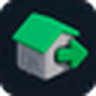
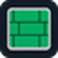
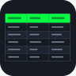

  <picture>
    <source media="(prefers-color-scheme: dark)" srcset="assets/logo-dark.png">
    
  </picture>

<h1 align="center">bim-helper</h1>

<b>Повторяющиеся задачи в Revit — за один запуск</b> Надстройка для Autodesk Revit 2022–2026

  

  
  
  

bim-helper добавляет в Revit вкладку с инструментами для повторяющихся задач BIM-инженера: выгрузки и очистки моделей, выпуска и копирования листов, подсчёта отделки и оформления воздуховодов. Настройки запоминаются между запусками.

## Инструменты

Сгруппированы так же, как на вкладке **bim-helper** в Revit. Нажмите «Подробнее», чтобы раскрыть описание.

### BIM

<table>
<tr>
<td width="64" align="center"></td>
<td>
<b>Экспорт модели</b> 
Пакетная выгрузка моделей в RVT, NWC и IFC: вручную или по расписанию

Подробнее

Выгружает список моделей с диска или с Revit Server в RVT, NWC и IFC за один запуск: сам открывает каждую модель, сохраняет файлы и закрывает её. Модели совместной работы открываются отсоединёнными — центральная модель не меняется, а ошибка в одной модели не останавливает остальные.

<ul><li>Модели с диска и с Revit Server, по несколько сразу</li><li>RVT для передачи — с очисткой листов, видов и связей или полной копией</li><li>Свои настройки NWC и IFC для каждого проекта</li><li>Выгрузка по расписанию: Revit запустится сам, выгрузит и закроется</li><li>Отчёт: сколько файлов, сколько времени, ошибки</li></ul>

</td>
</tr>
<tr>
<td width="64" align="center"></td>
<td>
<b>Очистка модели</b> 
Удаление лишних семейств, шаблонов видов, материалов, штриховок и CAD из проекта

Подробнее

Собирает в одном окне семейства, шаблоны видов, материалы, штриховки, связи и импорт CAD и удаляет отмеченное одним действием. После удаления окно остаётся открытым — очистку можно продолжать без повторного запуска.

<ul><li>По умолчанию — только семейства без размещённых экземпляров</li><li>Поиск по имени, выбор группы одним флажком</li><li>Защита элементов, занятых в совместной работе, — видно, кто занял</li><li>Отчёт: что удалено и что удалить не удалось</li></ul>

</td>
</tr>
</table>

### Диспетчер

<table>
<tr>
<td width="64" align="center"></td>
<td>
<b>Экспорт листов</b> 
Пакетный выпуск листов в PDF и DWG по разделам Диспетчера проекта

Подробнее

Выпускает отмеченные листы в PDF и DWG сразу по нескольким разделам Диспетчера проекта, без настройки печати для каждого листа. Формат определяется по основной надписи, файлы раскладываются по папкам разделов.

<ul><li>Форматы A0–A6, кратные и нестандартные — по основной надписи</li><li>PDF через встроенный экспорт Revit, PDF24 или другой принтер</li><li>Цвет, оттенки серого или чёрно-белый; раздел в один PDF-файл</li><li>DWG по сохранённым в проекте настройкам экспорта</li><li>Настройки запоминаются между запусками</li></ul>

</td>
</tr>
<tr>
<td width="64" align="center"></td>
<td>
<b>Копировать листы</b> 
Дублирование листов с видами, легендами и спецификациями в текущем проекте

Подробнее

Создаёт новые листы по образцу выбранных и ставит на них копии видов на те же места — без ручного дублирования каждого вида. Способ копирования, основная надпись и шаблон номеров задаются один раз на всю выборку.

<ul><li>Копии видов без детализации, с детализацией или зависимые</li><li>Легенды и спецификации — по выбору</li><li>Префиксы и суффиксы для номеров и имён; занятые номера не конфликтуют</li><li>Замена основной надписи у всех копий сразу</li><li>Отмена одним Ctrl+Z</li></ul>

</td>
</tr>
<tr>
<td width="64" align="center"></td>
<td>
<b>Копировать виды</b> 
Пакетное дублирование видов, легенд и спецификаций с префиксом и суффиксом в имени

Подробнее

Дублирует выбранные виды, легенды и спецификации одной операцией вместо поштучного дублирования в Диспетчере проекта. Способ копирования и шаблон имени задаются один раз на всю выборку.

<ul><li>Без детализации, с детализацией или как зависимые виды</li><li>Копию спецификации можно перевести в другую категорию</li><li>Префикс и суффикс к имени; занятые имена не конфликтуют</li><li>Отмена одним Ctrl+Z, настройки запоминаются</li></ul>

</td>
</tr>
<tr>
<td width="64" align="center"></td>
<td>
<b>Перенумерация</b> 
Массовая перенумерация листов с префиксом, шагом и предпросмотром новых номеров

Подробнее

Присваивает выбранным листам новые номера по шаблону «префикс + число + суффикс» с заданными началом и шагом. Новые номера видны до применения, а занятые номера пропускаются автоматически.

<ul><li>Префикс, начальный номер, шаг и суффикс</li><li>Предпросмотр новых номеров до изменения проекта</li><li>Сдвиг нумерации внутри выборки без конфликтов</li><li>Отмена одним Ctrl+Z</li></ul>

</td>
</tr>
<tr>
<td width="64" align="center"></td>
<td>
<b>Очистка диспетчера</b> 
Удаление листов, видов и спецификаций целыми разделами Диспетчера проекта

Подробнее

Показывает листы, виды и спецификации в структуре Диспетчера проекта и удаляет их пакетно — по одному или целыми разделами. Перед удалением запрашивается подтверждение.

<ul><li>Отметка на любом уровне дерева, включая весь раздел</li><li>Поиск по всей категории</li><li>Вместе с листом — размещённые на нём виды, по выбору</li><li>Отмена одним Ctrl+Z</li></ul>

</td>
</tr>
</table>

### Инструменты

<table>
<tr>
<td width="64" align="center"></td>
<td>
<b>Копировать стандарты</b> 
Перенос фильтров, шаблонов, параметров, листов и рабочих наборов из другого проекта

Подробнее

Переносит в текущий проект фильтры, шаблоны видов, параметры проекта, листы и рабочие наборы из другого открытого проекта или связи. До копирования виден статус каждой позиции, в конце — отчёт.

<ul><li>Источник — открытый проект или загруженная связь</li><li>Одноимённые фильтры обновляются и остаются подключены к видам</li><li>Листы переносятся с основной надписью, виды — по выбору</li><li>Отчёт: добавлено, обновлено, пропущено</li></ul>

</td>
</tr>
<tr>
<td width="64" align="center"></td>
<td>
<b>Строки 8 мм</b> 
Высота 8 мм для строк элементов в спецификации — без окон и настроек

Подробнее

Выставляет строкам спецификации высоту 8 мм без ручной подгонки. Запускается в открытой спецификации или на листе — спецификацию достаточно указать щелчком.

<ul><li>Выполняется сразу, без окон и настроек</li><li>Данные в столбцах не меняются</li><li>Отмена одним шагом</li></ul>

</td>
</tr>
<tr>
<td width="64" align="center"></td>
<td>
<b>Генератор штриховок</b> 
Новая штриховка на основе существующей: масштаб, поворот, тип и ориентация

Подробнее

Создаёт новую штриховку на основе имеющейся — с другим масштабом и поворотом, без ручного пересчёта шага и углов линий. Исходная штриховка не меняется.

<ul><li>Масштаб от ×0,1 до ×10, поворот от −180° до 180°</li><li>Чертёжная или моделирующая</li><li>Предпросмотр направления и шага линий</li><li>Имя новой штриховки подставляется само</li></ul>

</td>
</tr>
<tr>
<td width="64" align="center"></td>
<td>
<b>Оси 2D/3D</b> 
Переключение осей на текущем виде между 2D- и 3D-границами одним нажатием

Подробнее

Переводит оси на активном виде с 3D-границ на 2D и обратно — оба конца каждой оси за одно нажатие. Обрабатываются выделенные оси, а если ничего не выделено — все оси вида.

<ul><li>Выделенные оси или все оси на виде</li><li>Оба конца оси сразу</li><li>Изменения только на текущем виде, отмена одним шагом</li></ul>

</td>
</tr>
<tr>
<td width="64" align="center"></td>
<td>
<b>Выравнивание уровней</b> 
Растяжение 3D-границ всех уровней проекта по габаритам модели

Подробнее

Растягивает 3D-границы всех уровней до крайних габаритов модели. Помогает, когда уровень не появляется на новом разрезе или фасаде из-за слишком коротких границ.

<ul><li>Все уровни проекта за один запуск</li><li>Меняются только 3D-границы, 2D на видах не затрагиваются</li><li>Отмена одним шагом</li></ul>

</td>
</tr>
</table>

### Отделка

<table>
<tr>
<td width="64" align="center"></td>
<td>
<b>Ведомость отделки</b> 
Запись материалов и площадей отделки в параметры помещений и создание спецификации

Подробнее

Считает отделку по помещениям: стены, полы и потолки группируются по описанию, площади суммируются и записываются в параметры помещения. По готовым данным сразу создаётся спецификация — без ручного подсчёта площадей.

<ul><li>Стены, полы и потолки с отбором по типу</li><li>Площади в м² по каждому помещению</li><li>Групповая ведомость: одинаковые помещения — одной строкой</li><li>Недостающие параметры помещений создаются сами</li></ul>

</td>
</tr>
<tr>
<td width="64" align="center"></td>
<td>
<b>Номер помещения</b> 
Перенос номера помещения в стены, полы и потолки, которые в нём находятся

Подробнее

Находит для каждого элемента отделки помещение, в котором он расположен, и копирует в него номер или другой выбранный параметр помещения. Номера не нужно проставлять вручную перед ведомостью отделки.

<ul><li>Стены, полы и потолки с отбором по типу</li><li>Все помещения проекта или только выделенные</li><li>Любой параметр помещения: номер, имя и другие</li></ul>

</td>
</tr>
<tr>
<td width="64" align="center"></td>
<td>
<b>Список помещений</b> 
Объединение помещений с одинаковой отделкой в общий список номеров

Подробнее

Объединяет помещения с одинаковым набором отделки в группы и записывает список номеров вида «101, 102, 105» в элементы отделки и в помещения. На его основе строится групповая ведомость отделки.

<ul><li>Группировка по проекту, по уровням или по параметрам</li><li>Запись в экземпляр или тип элемента и в помещения</li><li>Все элементы проекта или только выделенные</li></ul>

</td>
</tr>
</table>

### ОВ

<table>
<tr>
<td width="64" align="center"></td>
<td>
<b>Толщина стенки</b> 
Заполнение толщины стенки, класса герметичности и наименования воздуховодов по таблице

Подробнее

Подбирает воздуховодам толщину стенки по таблице, определяет класс герметичности по изоляции и собирает наименование. Соединительные детали получают наибольшую толщину и самый строгий класс из примыкающих воздуховодов.

<ul><li>Вся модель, активный вид или выделенные элементы</li><li>Встроенная таблица по образцу ADSK или своя из Excel и CSV</li><li>Перезапись только отличающихся значений</li><li>Отчёт «было → стало» с выделением элементов в модели</li></ul>

</td>
</tr>
</table>

### Помощь

<table>
<tr>
<td width="64" align="center"></td>
<td>
<b>Поддержка</b> 
Обращение к разработчику прямо из Revit: ошибка или идея, со скриншотами

Подробнее

Открывает окно обращения к разработчику: выбираете инструмент, описываете ситуацию и прикладываете скриншоты или файлы. Кнопка доступна даже без открытого проекта.

<ul><li>Скриншот из буфера обмена — кнопкой или Ctrl+V</li><li>Прикрепление изображений и файлов</li><li>Сведения о работе надстройки добавляются автоматически</li></ul>

</td>
</tr>
</table>

## Установка

1. **Скачайте** [установщик](https://github.com/shelbywalkyo/bim-helper/releases/latest/download/bim-helper-setup.exe) — один файл для всех поддерживаемых версий Revit.
2. **Закройте Revit** — установщик подождёт и подскажет, если Revit ещё открыт.
3. **Запустите Revit** — инструменты появятся на вкладке **bim-helper**.

Права администратора не нужны. Новые версии приходят автоматически. Все выпуски — на странице [Releases](https://github.com/shelbywalkyo/bim-helper/releases).

---

Autodesk и Revit — товарные знаки Autodesk, Inc. bim-helper не связан с Autodesk.
